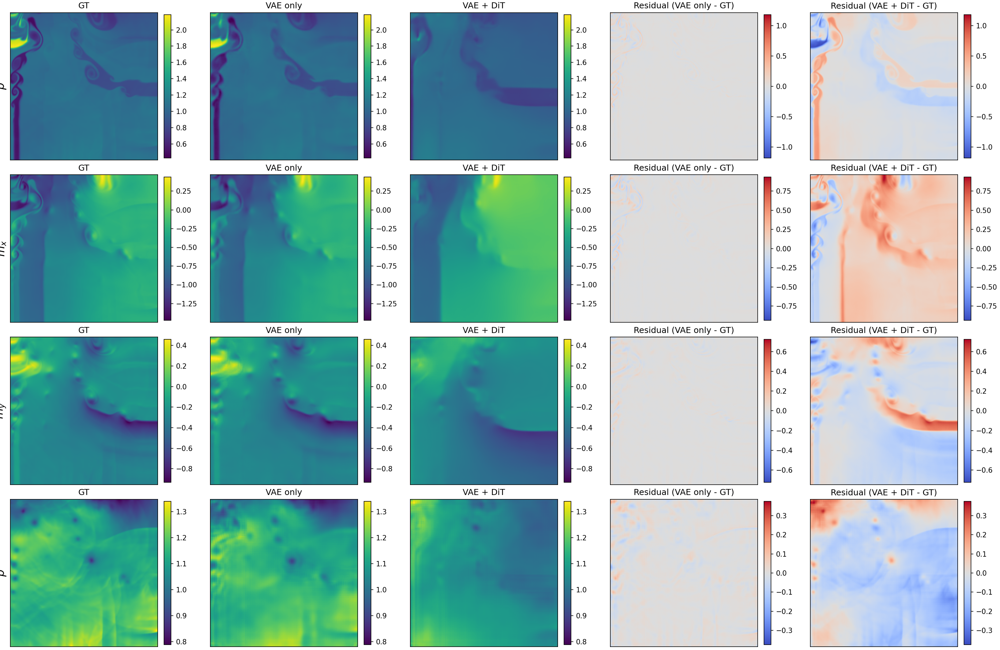

# Video Diffusion Models as Surrogates for Compressible-Flow CFD

Fine-tuning a pretrained text-to-video diffusion model (**LTX-Video, 2B**) to
forecast 2D compressible Euler flow with shocks: given the initial condition
and the heat-capacity ratio γ, the model rolls out a full 101-frame,
4-field (ρ, mₓ, m_y, p) simulation at 256×256.

This is my master's thesis project. It extends
[WinDiNet](https://arxiv.org/abs/2603.21210), which repurposed LTX-Video for
2-channel urban wind fields, to 4-channel shock-dominated flow. The core of
the thesis is a **controlled study of how to adapt the pretrained video VAE
to physical fields**, and how each VAE choice carries through to the
end-to-end generative model.


<sub>Frame 100 of one simulation (γ = 1.40; a training sim chosen for its rich
shock structure, shown for illustration only — all numbers below are on the
held-out test set). Columns: ground truth, VAE reconstruction, VAE + DiT
rollout from frame 0, and the two signed residuals.</sub>

## Highlights

- **Adapting an RGB video VAE to physics.** The pretrained VAE's 3-channel
  input/output convolutions are widened to 4 channels; the new pressure slot
  is zero-initialised while the RGB slots keep their pretrained weights.
  Thirteen single-variable ablations (adaptation depth, loss, LR, resolution,
  latent regularisation) on 500 test simulations show that **full
  fine-tuning is required, and the pressure channel is why**: with a frozen
  encoder the pressure error stays at 0.30 VRMSE, vs 0.11 with full
  fine-tuning.
- **Reconstruction quality does not predict generation quality.** Training a
  separate DiT on each VAE's latents shows that the ranking changes: a VAE
  regularised with **score distillation (SDS) from the stock video DiT** ties
  the baseline on reconstruction but gives the **best end-to-end pipeline
  (−8.1% VRMSE, better on 443/500 test sims and on all 10 γ values)**. A
  KL-regularised VAE that is 9.6% *worse* at reconstruction is 5.0% *better*
  end to end.
- **Physics conditioning instead of text.** Text conditioning is replaced by
  Fourier-feature embeddings of γ; frame 0 conditions the rollout.
- **Careful evaluation.** Channel-mean VRMSE on a separate test file, paired
  per-simulation comparisons and Wilcoxon tests, a measured ~1% seed/cluster
  noise floor, and latent-space fingerprinting so a DiT can never be decoded
  with a mismatched VAE. Debugging the evaluation (posterior *sample* vs.
  *mean* for the conditioning frame) reversed an earlier conclusion about KL
  regularisation (see [RESULTS.md](RESULTS.md#evaluation-protocol-note)).
- **HPC engineering.** Multi-GPU training with Accelerate on two
  architectures (Intel Data Center GPU Max 1550 and NVIDIA GH200), bf16,
  gradient checkpointing, resumable state, and reproducible splits.

Full tables, per-γ breakdowns and limitations: **[RESULTS.md](RESULTS.md)**.

## Method

```
Stage 1  VAE      CFD fields (ρ, mₓ, m_y, p), 101 × 256 × 256
                  -> LTX-Video VAE with conv_in/conv_out widened 3 -> 4 channels
                  -> fine-tuned with RMSE + 50·H1 (+ optional KL / SDS latent prior)
                  -> latent 14 × 8 × 8 × 128 (32× spatial, 8× temporal compression)

Stage 2  DiT      LTX-Video transformer (2B), flow matching on the frozen VAE's latents
                  conditioned on the clean first latent frame + γ (Fourier features)

Inference         encode frame 0 -> DiT rolls out the remaining latent frames (20 steps)
                  -> VAE decoder -> 4 physical fields
```

| Component | Where |
|---|---|
| VAE channel adapter (inflate / colour-adapter modes) | [`windinet/vae_adapter.py`](windinet/vae_adapter.py) |
| Reconstruction losses: RMSE, H1/H2 semi-norms, SSIM, wavelet MLW, VRMSE | [`windinet/losses/`](windinet/losses/) |
| Latent regularisers: KL, SDS from the stock DiT, sliced-Wasserstein prior | [`kl_divergence.py`](windinet/losses/kl_divergence.py), [`sds_loss.py`](windinet/training/sds_loss.py), [`sliced_wasserstein.py`](windinet/losses/sliced_wasserstein.py) |
| Loss weighting (fixed, GradNorm, SoftAdapt) | [`windinet/loss_weighting/`](windinet/loss_weighting/) |
| Scalar (γ) conditioning | [`windinet/scalar_embeddings.py`](windinet/scalar_embeddings.py) |
| VAE / DiT trainers | [`windinet/training/`](windinet/training/) |
| Inference pipeline + latent-space fingerprint check | [`windinet/inference/`](windinet/inference/) |

## Results at a glance

Test set: 500 simulations, 10 γ values. Metric: channel-mean VRMSE
(lower is better). Differences of about 1% or less are within the measured
noise floor.

**VAE reconstruction** (selected arms; all of them in [RESULTS.md](RESULTS.md)):

| VAE | Ch-mean VRMSE | Δ vs. baseline | Pressure VRMSE |
|---|---|---|---|
| Unfinetuned (widened only) | 0.557 | +596% | 1.859 |
| Decoder only | 0.144 | +80% | 0.298 |
| Decoder + conv_in | 0.093 | +16% | 0.130 |
| **Full fine-tune (baseline)** | **0.080** | — | **0.106** |
| Trained at 128² | 0.120 | +50% | 0.157 |

**End-to-end VAE + DiT rollout** (one DiT trained per VAE, identical recipe):

| VAE | VAE only | VAE + DiT | Δ vs. baseline | Sims better than baseline |
|---|---|---|---|---|
| Full fine-tune (baseline) | 0.080 | 0.498 | — | — |
| Unfinetuned | 0.558 | 0.950 | +90.6% | 0/500 |
| KL 1e-5 | 0.088 | 0.473 | −5.0% | 369/500 |
| **SDS 1e-2** | 0.081 | **0.458** | **−8.1%** | **443/500** |
| SDS 1 | 0.104 | 0.568 | +13.9% | 85/500 |

The DiT rollout error is 5–6× the VAE's reconstruction floor, so the
generative model, not the autoencoder, is the bottleneck. That is why the
*shape* of the latent space matters more than small reconstruction gains.

## Quick start

**Requirements:** Python ≥ 3.10, PyTorch ≥ 2.6, one or more GPUs with ≥ 48 GB
(CUDA or Intel XPU). The base LTX-Video weights download automatically from
HuggingFace.

```bash
pip install -e ".[training]"

# Data: Euler multi-quadrant dataset (HDF5) -> data/euler_mq/256x256_ds/
python scripts/download_data.py 256x256_ds
```

**1. Fine-tune the VAE** (about 3.5 h on 4× GH200 for 20 epochs):

```bash
accelerate launch --num_processes 4 scripts/finetune_vae.py configs/vae/baseline.yaml
python scripts/eval_vae_test.py configs/vae/baseline.yaml \
    --checkpoint outputs/vae/baseline/checkpoints/vae_shockwave_best.safetensors \
    --test-h5 data/euler_mq/256x256_ds/test.h5 \
    --output outputs/vae/baseline/test_eval_256.json
```

Every file in [`configs/vae/ablations/`](configs/vae/ablations/) changes
exactly one setting of the baseline.

**2. Encode the dataset into latents** with the fine-tuned VAE:

```bash
python scripts/preprocess_dataset.py data/euler_mq/256x256_ds/train.h5 \
    --output-dir outputs/latents/baseline \
    --inflate-checkpoint outputs/vae/baseline/checkpoints/vae_shockwave_best.safetensors \
    --eval-sims 500
```

**3. Train the DiT** on those latents:

```bash
accelerate launch --num_processes 8 scripts/train.py configs/dit/train.yaml
```

**4. Evaluate / roll out:**

```bash
# Test-set VRMSE: VAE-only floor vs. full VAE + DiT rollout
python scripts/eval_dit_vrmse.py configs/dit/inference.yaml \
    --preprocessed_data_root outputs/latents/baseline \
    --test_h5 data/euler_mq/256x256_ds/test.h5 --out_dir outputs/eval/baseline

# Save rollouts as .npz and render them
python scripts/inference_shockwave.py configs/dit/inference.yaml \
    --h5 data/euler_mq/256x256_ds/test.h5 --out_dir predictions/ --num_samples 8
python scripts/visualize_dit_predictions.py --help
```

Diagnostics: [`scripts/latent_stats.py`](scripts/latent_stats.py) and
[`scripts/latent_shift_metrics.py`](scripts/latent_shift_metrics.py) measure
how the latent distribution shifts away from what the pretrained DiT expects.

## Repository layout

| Path | Contents |
|---|---|
| `windinet/` | Library: VAE adapter, losses, conditioning, trainers, inference pipeline |
| `scripts/` | Entry points: data download, training, preprocessing, evaluation, diagnostics, figures |
| `configs/vae/` | Baseline VAE recipe + one config per ablation |
| `configs/dit/` | DiT training and inference configs |
| `configs/data/` | Per-channel normalisation statistics |
| `RESULTS.md` | Full results, findings and limitations |

## Acknowledgements

Builds on [WinDiNet](https://arxiv.org/abs/2603.21210) and on
[LTX-Video-Trainer](https://github.com/Lightricks/LTX-Video-Trainer) by
Lightricks; the base model is
[LTX-Video](https://github.com/Lightricks/LTX-Video). Dataset:
[`rha6696/euler_mq`](https://huggingface.co/datasets/rha6696/euler_mq).
Licensed under Apache 2.0 (see [LICENSE](LICENSE)).
